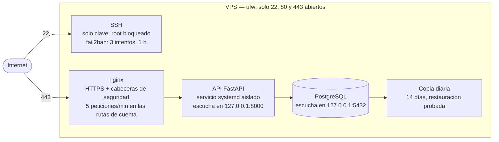

# Montar y securizar un VPS para una aplicación móvil

Documentación del servidor que da servicio a **DexClub**, una aplicación de
colección de cartas publicada en Google Play y en la App Store. El
servidor guarda las cuentas y sincroniza la colección entre
dispositivos.

No es un tutorial copiado: es lo que hice, en el orden en que lo hice, con
las comprobaciones que demuestran que cada cosa funciona y **los cuatro
tropiezos de configuración** que me encontré por el camino, que
probablemente sea lo más útil de todo el documento.

> En todo el texto, `<IP>` es la dirección pública del servidor y
> `<usuario>` la cuenta de administración. Los valores reales no se
> publican. Las direcciones de los bots que salen en los registros van
> recortadas (`45.148.x.x`): suelen ser equipos ajenos comprometidos, no
> del atacante.



---

## Índice

1. [Punto de partida](#1-punto-de-partida)
2. [Estado inicial](#2-estado-inicial)
3. [Usuario y acceso por clave](#3-usuario-y-acceso-por-clave)
4. [Endurecer SSH](#4-endurecer-ssh)
5. [Cortafuegos: dos capas](#5-cortafuegos-dos-capas)
6. [fail2ban](#6-fail2ban)
7. [PostgreSQL](#7-postgresql)
8. [La API como servicio](#8-la-api-como-servicio)
9. [HTTPS con nginx y Let's Encrypt](#9-https-con-nginx-y-lets-encrypt)
10. [Copias de seguridad](#10-copias-de-seguridad)
11. [Incidencias](#11-incidencias)
12. [Antes y después](#12-antes-y-después)

---

## 1. Punto de partida

| | |
|---|---|
| Fecha | Septiembre de 2026 |
| Proveedor | VPS con 2 vCPU, 4 GB de RAM y 120 GB de disco |
| Sistema | Ubuntu 26.04 LTS, imagen del proveedor |
| Servicios | PostgreSQL, API en FastAPI, nginx como proxy |
| Acceso inicial | root con contraseña, facilitado por el panel |

El objetivo no era solo "que funcione", sino que **funcione sin
vigilancia**: que arranque solo, que se renueve el certificado solo, que
haga copias solo y que el ruido de internet no llegue a molestar.

Antes de esto, todo el montaje se había ensayado en una máquina virtual
local. Fue tiempo bien invertido: los dos problemas más raros ya los
conocía.

---

## 2. Estado inicial

Lo primero, antes de tocar nada, es **guardar cómo venía la máquina**. Es
la única forma de demostrar después qué se cerró.

```bash
{ echo "== SISTEMA =="; lsb_release -a;
  echo "== HORA =="; timedatectl;
  echo "== PUERTOS A LA ESCUCHA =="; ss -tulpn;
  echo "== SERVICIOS ACTIVOS =="; systemctl list-units --type=service --state=running --no-pager;
} > ~/estado-inicial.txt 2>&1
```

Lo que salió:

| Puerto | Escucha en | Qué es |
|---|---|---|
| 22 | `0.0.0.0` y `[::]` | SSH, **el único abierto a internet** |
| 53 | `127.0.0.54` / `127.0.0.53` | Resolución DNS interna |
| 323 | `127.0.0.1` / `[::1]` | Sincronización de hora |
| 68 | la interfaz | Cliente DHCP |

La imagen venía razonablemente limpia: reloj sincronizado,
`unattended-upgrades` ya activo y nada de más escuchando hacia fuera.

**Dos servicios que sobran en un VPS** y se desactivaron:

```bash
systemctl disable --now ModemManager fwupd
```

`ModemManager` gestiona módems que no existen en una máquina virtual, y
`fwupd` actualiza firmware de hardware físico. Ninguno aporta nada aquí, y
todo servicio que no se usa es superficie de ataque gratis.

`multipathd` y `udisks2` se dejaron: tocan almacenamiento y el riesgo de
romper algo supera lo que se gana.

**La zona horaria se dejó en UTC** a propósito: los registros quedan sin
saltos de horario de verano y son comparables con los de cualquier otro
sistema.

---

## 3. Usuario y acceso por clave

**Por qué.** Trabajar como root es el fallo de base: cualquier error o
cualquier proceso comprometido tiene control total, y además no queda
rastro de quién hizo qué.

```bash
adduser <usuario>
usermod -aG sudo <usuario>
```

**La clave, nueva y solo para este servidor.** Reutilizar una clave que ya
usas en otros sitios significa que, si se compromete, se compromete todo:

```powershell
ssh-keygen -t ed25519 -C "dexclub-vps" -f $env:USERPROFILE\.ssh\dexclub_vps
type $env:USERPROFILE\.ssh\dexclub_vps.pub | ssh <usuario>@<IP> "mkdir -p ~/.ssh && chmod 700 ~/.ssh && cat >> ~/.ssh/authorized_keys && chmod 600 ~/.ssh/authorized_keys"
```

`ed25519` en vez de RSA: claves más cortas, más rápidas y sin los tamaños
de RSA que hay que ir subiendo con los años. Y **con frase de paso**, que
es lo que evita que quien copie el archivo pueda usarlo tal cual.

**Comprobación.** Entrar con la clave **desde otra terminal, antes de
cerrar nada**. Este es el paso que la gente se salta y por el que acaba
encerrada fuera de su propio servidor.

```bash
ls -la ~/.ssh
# drwx------  .ssh
# -rw-------  authorized_keys
```

Permisos estrictos porque **SSH ignora las claves de archivos que puedan
leer otros**: es una protección del propio protocolo, no una manía.

---

## 4. Endurecer SSH

**Por qué.** Un servidor con SSH abierto recibe miles de intentos diarios
de bots probando usuarios y contraseñas comunes. Con claves, esos intentos
dejan de tener sentido.

Lo que se aplicó, en `/etc/ssh/sshd_config.d/01-dexclub.conf`:

```
PasswordAuthentication no      # sin contraseñas que adivinar
KbdInteractiveAuthentication no
PermitRootLogin no             # obliga a entrar como usuario y escalar con sudo
PubkeyAuthentication yes
AllowUsers <usuario>           # aunque exista otra cuenta, no entra por SSH
MaxAuthTries 3
LoginGraceTime 30              # menos tiempo con conexiones a medio abrir
```

**El número del archivo importa, y no como uno espera.** Ver
[Incidencias](#11-incidencias).

**Comprobación.** No vale leer el archivo: hay que preguntarle al programa
qué configuración tiene de verdad.

```bash
sudo sshd -T | grep -E "^(passwordauthentication|permitrootlogin|allowusers|maxauthtries)"
# passwordauthentication no
# permitrootlogin no
# allowusers <usuario>
# maxauthtries 3
```

Y desde fuera:

```
$ ssh root@<IP>
root@<IP>: Permission denied (publickey).
```

---

## 5. Cortafuegos: dos capas

Hay **dos cortafuegos distintos**, y esto confunde al principio:

**El del panel del proveedor** filtra antes de llegar a la máquina. Un
puerto cerrado ahí no se abre desde dentro por mucho que se configure.

**El de la máquina (ufw)** filtra lo que ya llegó.

Las dos capas tienen que permitir el tráfico. No es redundante: si mañana
instalo algo que se pone a escuchar, ufw lo tapa aunque el puerto siga
abierto en el panel.

**En el panel** venían abiertos 22, 80, 443 y además **8443 y 8447**, los
del panel de administración Plesk, que no se instaló. Se borraron: una
regla abierta que no se usa es superficie de ataque sin contrapartida.

**En la máquina:**

```bash
sudo ufw default deny incoming     # lo que no se abre, no entra
sudo ufw default allow outgoing    # el servidor sí necesita salir
sudo ufw allow OpenSSH
sudo ufw allow 80/tcp
sudo ufw allow 443/tcp
sudo ufw enable
```

Denegar por defecto y abrir lo justo, en vez de ir cerrando puertos uno a
uno: así lo que se instale mañana no queda expuesto por accidente.

El 80 se abre aunque todo el tráfico acabe siendo HTTPS, porque Let's
Encrypt lo necesita para validar el dominio.

**Comprobación:**

```
Status: active
Default: deny (incoming), allow (outgoing), disabled (routed)

To                         Action      From
22/tcp (OpenSSH)           ALLOW IN    Anywhere
80/tcp                     ALLOW IN    Anywhere
443/tcp                    ALLOW IN    Anywhere
```

En `estados/estado-final.txt` ese mismo listado sale con varias reglas
`REJECT IN` por encima. No están en la configuración: las escribe
fail2ban sobre la marcha y desaparecen solas cuando caduca el bloqueo.

---

## 6. fail2ban

**Por qué.** El 22 tiene que estar abierto sí o sí. fail2ban mira quién
falla al entrar y lo bloquea un rato.

Con las contraseñas ya desactivadas, **no está tapando un agujero: está
quitando ruido**. Cada intento consume proceso, llena el registro y esconde
lo que sí importa. Es defensa en capas.

`/etc/fail2ban/jail.d/99-dexclub.local`:

```
[DEFAULT]
bantime  = 1h
findtime = 10m
maxretry = 3
banaction = ufw    # que el bloqueo lo aplique el mismo cortafuegos

[sshd]
enabled = true
```

`banaction = ufw` para no tener dos cortafuegos distintos escribiendo
reglas sobre la misma máquina.

**Comprobación:**

```bash
sudo fail2ban-client get sshd bantime    # 3600
sudo fail2ban-client get sshd maxretry   # 3
sudo fail2ban-client status sshd
```

### Lo que recibe un servidor recién encendido

Medido en las **dos primeras horas** de vida de la máquina:

```bash
sudo journalctl -u ssh --since "2 hours ago" | grep -oP "from \K[0-9.]+" | sort | uniq -c | sort -rn | head
#    618 103.174.x.x
#     14 2.57.x.x
#     10 27.72.x.x
```

Y los usuarios que probaban:

```
5 admin
2 ftpuser
2 aleisha
1 frappe
1 1
```

Ninguno podía entrar: no existen, y el acceso por contraseña ya estaba
desactivado. Pero **618 peticiones desde una sola dirección en dos horas**
explica mejor que cualquier argumento por qué no se deja un servidor con
la configuración de fábrica.

### Tres semanas después

Lo de arriba son las dos primeras horas. Con la máquina ya en producción,
esto es lo que llevaba acumulado la cárcel de sshd:

```
Currently failed:    2
Total failed:     2037
Currently banned:    6
Total banned:      267
```

Ninguno habría entrado de todas formas: no hay contraseñas que probar.
Pero son **2037 conexiones que ya no llegan** al daemon ni al registro,
y seis direcciones bloqueadas en este mismo momento. Una configuración
que parece correcta y una que se ve trabajando no son lo mismo.

---

## 7. PostgreSQL

**Lo más importante es dónde escucha:**

```bash
sudo ss -tulpn | grep 5432
# tcp LISTEN 127.0.0.1:5432
```

La API vive en la misma máquina, así que la base de datos no necesita
salir a la red. En local significa que, aunque alguien acertara la
contraseña, no tendría por dónde entrar. Por eso el 5432 no se abre en
ningún cortafuegos.

**Usuario propio para la aplicación**, sin superusuario, y con nombre
distinto del de la base de datos para que no se confundan:

```sql
CREATE USER <usuario_bd>;
\password <usuario_bd>          -- ver Incidencias
CREATE DATABASE dexclub OWNER <usuario_bd>;
\c dexclub
GRANT ALL ON SCHEMA public TO <usuario_bd>;
```

**Esa última línea es obligatoria desde PostgreSQL 15**: ser dueño de la
base de datos ya no da permisos sobre el esquema `public`. Es un cambio
que rompe casi todos los tutoriales anteriores a esa versión.

**Comprobación:**

```bash
psql -h 127.0.0.1 -U <usuario_bd> -d dexclub -c "\dn+"
# public | pg_database_owner | ... <usuario_bd>=UC/pg_database_owner
```

### El esquema

Seis archivos que se aplican en orden, cada uno idempotente para poder
relanzarlo sin romper nada. 13 tablas: cuentas, colección, certificadas,
álbumes, listas de deseados, barajas, torneos, partidas y etiquetas.

Dos decisiones que condicionan todo lo demás:

**Las bajas se marcan, no se borran.** Si una fila desapareciera sin dejar
rastro, un dispositivo que no se hubiera sincronizado la volvería a subir
creyendo que al servidor le faltaba. Marcarla deja constancia de que fue
una decisión.

**La fecha de modificación la pone el servidor**, con un trigger, nunca el
cliente. Si cada móvil mandara la suya, bastaría con tener el reloj mal
para que sus cambios ganaran siempre. Y los relojes de los móviles se
desajustan solos.

---

## 8. La API como servicio

**Por qué.** Arrancarla a mano significa que se cae al cerrar la sesión y
no vuelve sola tras un reinicio.

`/etc/systemd/system/dexclub-api.service`, con la parte interesante:

```ini
Restart=always
RestartSec=5

NoNewPrivileges=true         # no puede ganar privilegios ni con binarios setuid
PrivateTmp=true              # su /tmp es suyo, no ve el del resto
ProtectSystem=strict         # todo el disco en solo lectura...
ReadWritePaths=/home/<usuario>/api   # ...salvo su propia carpeta
ProtectHome=read-only
ProtectKernelTunables=true
ProtectControlGroups=true
RestrictAddressFamilies=AF_INET AF_INET6 AF_UNIX
```

Ese bloque es el que convierte el servicio en algo acotado: **si algún día
alguien consigue ejecutar código a través de la API, se encuentra un disco
de solo lectura y sin forma de escalar privilegios.**

Las credenciales van en un `.env` con permisos `600`, fuera del
repositorio. El entorno de Python es un *venv*: Ubuntu 26.04 ya no deja
instalar paquetes en el sistema, y además así las versiones de la
aplicación no dependen de las del sistema operativo.

**La API escucha solo en `127.0.0.1`**: quien habla con ella desde fuera es
nginx. Nunca está expuesta directamente.

**Comprobación de verdad:** reiniciar la máquina entera.

```bash
sudo reboot
# ...
systemctl is-active dexclub-api     # active
curl -s http://127.0.0.1:8000/estado # {"ok":true}
sudo ufw status | head -3            # Status: active
```

---

## 9. HTTPS con nginx y Let's Encrypt

**Por qué un proxy delante.** La API no gestiona certificados ni límites de
peticiones, y no debería: nginx hace eso mucho mejor y deja a la API
dedicarse a lo suyo. Además, así la aplicación nunca toca internet
directamente.

**El subdominio** `api.<dominio>` se crea con un registro A apuntando a la
IP. Conviene hacerlo con antelación: hasta que no propaga, Let's Encrypt no
puede validar y cada intento fallido consume cuota.

```bash
dig +short api.<dominio>    # debe devolver <IP>
```

**El certificado:**

```bash
sudo certbot --nginx -d api.<dominio>
```

Deja configurada la renovación automática. La comprobación que importa no
es que el certificado exista, sino que **se renovará solo dentro de tres
meses**:

```bash
sudo certbot renew --dry-run
# Congratulations, all simulated renewals succeeded
```

**Cabeceras de seguridad**, dentro del bloque del 443:

```nginx
add_header Strict-Transport-Security "max-age=31536000; includeSubDomains" always;
add_header X-Content-Type-Options "nosniff" always;
add_header Referrer-Policy "no-referrer" always;
add_header X-Frame-Options "DENY" always;
server_tokens off;
```

`server_tokens off` también en la configuración global: si solo se pone en
el sitio, **las páginas de error que genera nginx fuera del bloque siguen
enseñando la versión**, que es justo lo que busca quien rastrea fallos
conocidos.

**Límite de peticiones** en las rutas de cuenta, que es donde alguien
probaría contraseñas a lo bruto. Esto fail2ban no lo ve: es tráfico HTTP
normal.

```nginx
# en nginx.conf, dentro de http
limit_req_zone $binary_remote_addr zone=cuentas:10m rate=5r/m;

# en el sitio, para /login y /registro
limit_req zone=cuentas burst=3 nodelay;
```

Cinco por minuto con margen de tres. Una persona que se equivoca de
contraseña nunca llega ahí; un ataque por fuerza bruta, a la primera.

**Comprobación:**

```bash
for i in $(seq 1 10); do curl -s -o /dev/null -w "%{http_code} " -X POST https://api.<dominio>/login; done
# 422 422 422 422 422 422 422 422 503 503
```

Y las cabeceras:

```bash
curl -s -D - -o /dev/null https://api.<dominio>/estado
# HTTP/1.1 200 OK
# Server: nginx
# Strict-Transport-Security: max-age=31536000; includeSubDomains
# X-Content-Type-Options: nosniff
# Referrer-Policy: no-referrer
# X-Frame-Options: DENY
```

> Detalle: `curl -I` envía una petición HEAD y la API responde `405`. Hay
> que usar `-D -` para ver las cabeceras de una respuesta normal.

---

## 10. Copias de seguridad

Un volcado diario, rotación de 14 días y **restauración probada**.

La contraseña no va dentro del script: se lee de `~/.pgpass`, que
PostgreSQL **ignora si no tiene permisos `600`**. Así el script se puede
leer, copiar o publicar sin filtrar nada.

```bash
umask 077     # las copias llevan datos de usuarios: solo las lee su dueño

pg_dump -h 127.0.0.1 -U <usuario_bd> -d dexclub --clean --if-exists \
  | gzip > "$ARCHIVO"

# Un archivo vacío es peor que ninguno: parece que hay copia.
[ -s "$ARCHIVO" ] || { echo "La copia salió vacía" >&2; exit 1; }

find "$DESTINO" -name 'dexclub_*.sql.gz' -mtime +14 -delete
```

Catorce días porque, si un fallo no se ha notado en dos semanas, tampoco se
va a arreglar volviendo a esa fecha.

Programado con cron a las 4:30, cuando nadie usa la aplicación.

**La comprobación que casi nadie hace**, y la única que demuestra que la
copia sirve:

```bash
sudo -u postgres psql -c "CREATE DATABASE prueba_restaura OWNER <usuario_bd>;"
gunzip -c ~/copias/dexclub_*.sql.gz | psql -h 127.0.0.1 -U <usuario_bd> -d prueba_restaura
psql -h 127.0.0.1 -U <usuario_bd> -d prueba_restaura -c "\dt"   # 13 tablas
sudo -u postgres psql -c "DROP DATABASE prueba_restaura;"
```

**Pendiente, y conviene decirlo:** estas copias viven en el mismo disco que
la base de datos. Una copia que solo existe en la máquina que puede fallar
no es una copia. El siguiente paso es descargarlas fuera.

---

## 11. Incidencias

La parte más útil del documento. Cuatro tropiezos, y **una lección
común**.

### 1. La configuración de SSH que no se aplicaba

**Qué pasó.** La imagen del proveedor trae
`/etc/ssh/sshd_config.d/50-cloud-init.conf` con `PasswordAuthentication
yes`, que anula lo que diga `sshd_config`. Puse mi configuración en un
archivo `99-` pensando que ganaba el último en leerse.

No fue así: **SSH se queda con el primer valor que encuentra**. Como los
archivos se procesan en orden alfabético, el `yes` del `50-` ya estaba
fijado cuando llegaba mi `no`.

Lo curioso es que el resto de mis ajustes **sí** se aplicaron —
`PermitRootLogin`, `AllowUsers`— porque nadie los había fijado antes. Un
archivo a medias funcionando es más difícil de detectar que uno que no
funciona en absoluto.

**Cómo se detectó.** `sudo sshd -T` muestra la configuración efectiva.
Ahí seguía apareciendo `passwordauthentication yes` mientras el archivo
decía lo contrario.

**Solución.** Renombrar a `01-dexclub.conf`, para que se lea antes.

### 2. fail2ban, exactamente al revés

**Qué pasó.** Configuré `jail.local` con una hora de bloqueo y tres
intentos. Al comprobarlo, el baneo había expirado a los diez minutos.

```bash
sudo fail2ban-client get sshd bantime    # 600  (el valor por defecto)
sudo fail2ban-client get sshd maxretry   # 5
```

`/etc/fail2ban/jail.d/defaults-debian.conf` se lee **después** de
`jail.local` y lo pisa. Aquí **gana el último**, justo al contrario que en
SSH.

**Solución.** Poner la configuración en `jail.d/99-dexclub.local`.

### 3. La contraseña que rompía la conexión

**Qué pasó.** Creé el usuario de PostgreSQL con `CREATE USER ... WITH
PASSWORD 'x'` y la contraseña acabó guardada con texto mezclado. Además
llevaba `@`, `ñ` y `!`, y eso rompe la cadena de conexión: **la `@` es el
separador entre credenciales y servidor** en una URL, y el `!` lo
interpreta la propia terminal.

```
psql: error: unexpected spaces found in "...", use percent-encoded spaces (%20) instead
```

**Solución.** Fijar la contraseña con `\password`, que la pide sin
mostrarla y sin pasar por comillas, y conectar con parámetros
(`-h -U -d`) en vez de con una URL. Así los caracteres especiales dejan de
importar.

### 4. El SSH que figuraba desactivado

**Qué pasó.** Al repasar el estado final, `systemctl is-enabled ssh`
devolvía `disabled` mientras el servicio estaba `active`. Leído tal cual:
SSH funciona ahora pero no arrancaría en el próximo reinicio, que en una
máquina remota significa quedarse fuera.

**Por qué era así.** Ubuntu arranca SSH por *socket*. Quien escucha en el
22 y levanta el daemon cuando entra una conexión es `ssh.socket`, no
`ssh.service`; el servicio figura desactivado porque no es él quien tiene
que arrancar solo.

```bash
systemctl is-enabled ssh.socket   # enabled
systemctl is-active  ssh.socket   # active
```

**Por qué lo cuento aunque no rompiera nada.** Es el único de los cuatro
que no me costó tiempo, y es el que más me podría haber costado: la
reacción natural ante un `disabled` es habilitar `ssh.service`, y se
acaba con dos unidades peleándose por el mismo puerto. La comprobación de
verdad ya estaba hecha sin saberlo, en el reinicio del punto 8: SSH
volvió solo.

**Solución.** Ninguna, estaba bien. Lo que cambió fue la captura del
estado, que ahora pregunta por las dos unidades para que la diferencia se
vea en vez de confundir.

### La lección común

Las cuatro veces lo que yo creía y lo que hacía la máquina no coincidían,
y las cuatro se destaparon igual: **preguntándole al programa qué
configuración tiene, en vez de leer el archivo.**

```bash
sudo sshd -T                      # SSH
sudo fail2ban-client get <cárcel> # fail2ban
systemctl is-enabled <unidad>     # qué arranca solo, y cuál
sudo ss -tulpn                    # qué escucha de verdad
sudo ufw status verbose           # qué filtra de verdad
```

Y dos conclusiones. Para cualquier servicio con directorios `.d`, **no des
por hecho quién gana**: en SSH, el primero; en fail2ban, el último.
Compruébalo siempre. Y antes de eso, **no des por hecho cómo se llama lo
que quieres comprobar**: preguntarle a la unidad equivocada devuelve una
respuesta correcta a otra pregunta.

---

## 12. Antes y después

| | Al empezar | Al terminar |
|---|---|---|
| Acceso | root con contraseña | Usuario normal, solo clave, root bloqueado |
| Usuarios por SSH | Todos | Uno (`AllowUsers`) |
| Intentos fallidos | Sin límite | 3, luego una hora de bloqueo |
| Bloqueos reales | — | 267 direcciones en tres semanas |
| Puertos abiertos | 22, 80, 443, 8443, 8447 (panel) | 22, 80, 443 |
| Base de datos | — | Solo en local, usuario sin privilegios |
| Aplicación | — | Servicio aislado, arranca sola |
| Tráfico | — | HTTPS obligatorio, renovación automática |
| Fuerza bruta web | — | 5 intentos/minuto en rutas de cuenta |
| Copias | Ninguna | Diarias, rotadas y con restauración probada |

### Lo que queda pendiente

- Sacar las copias fuera del servidor.
- Cárceles de fail2ban para nginx, cuando haya tráfico real que analizar.
- Revisar los registros a los pocos días: qué llega, qué se bloquea y si
  algo legítimo está cayendo por error.

---

## Cómo está organizado esto

```
vps-hardening-ubuntu/
├── README.md                 este documento
├── ejemplos/
│   ├── sshd_01-dexclub.conf
│   ├── jail.d_99-dexclub.local
│   ├── nginx-dexclub-api.conf
│   ├── dexclub-api.service
│   ├── copia.sh
│   └── env.ejemplo           con valores falsos
└── estados/
    ├── estado-inicial.txt
    └── estado-final.txt
```

**Nada de lo que hay aquí incluye la IP real, el nombre de usuario, claves
ni contraseñas.** Los números de configuración sí: no son secretos y son lo que hace útil este documento.
